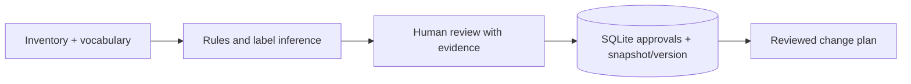

# obs-agent — Cloud Label Review

[](https://github.com/redbarron23/obs-agent/actions/workflows/ci.yml)

**Turn missing or suspect Azure/GCP labels into a reviewed change plan.** Import an inventory,
inspect ownership evidence, accept or override suggestions, and export the before/after changes.
Label review runs locally without an LLM or cloud credentials. Optional cost chat uses synthetic data.


## Quick start

Requirements: Python **3.11+** and [uv](https://docs.astral.sh/uv/).

```bash
git clone https://github.com/redbarron23/obs-agent.git
cd obs-agent
uv sync --locked
uv run streamlit run app.py
```

Open the local URL printed by Streamlit. **Label review** is the landing page. Enter your reviewer
name or ID, inspect a suggestion, save a decision, and download **Reviewed change plan**.
Start with the bundled synthetic inventory; no API keys or Ollama setup are needed.

For disposable demo decisions, run `OBS_AGENT_DEMO=1 uv run streamlit run app.py`.
See the [five-minute walkthrough](docs/five-minute-demo.md).

## Use your own inventory

1. Open **Import / reopen inventory** and download the CSV and vocabulary examples.
2. Upload your sanitized Azure subscription/GCP project snapshot. If its headers differ from the
   CSV schema, map them on the page. Supply your own team/environment values and aliases in the
   optional vocabulary JSON.
3. Select **Save and open review**, then review suggestions and export a plan.
4. Return to **Import / reopen inventory** to resume a saved snapshot after a browser or app restart.
5. Next cycle, save the new snapshot and open **Compare snapshots** to review only what changed.

Snapshots, vocabularies, and approvals persist locally in `review-workspaces/` (configurable with
`OBS_AGENT_REVIEW_DIR`). Keep this private directory outside version control and back it up.
Imports are available in the review UI; the REST API and optional chat use the synthetic estate.
The public demo disables private imports. See [Import inventory](docs/importing.md).

## What you get

- Missing/suspect `team` and `env` suggestions with evidence, confidence, and alternatives.
- A SQLite decision history with reviewer identity, timestamps, inventory fingerprint, and inference version.
- Reviewed-only JSON change plans and CSV, shell, or Terraform exports. A cost center accompanies
  a team change only when the inventory establishes an unambiguous mapping.
- Explicit opt-in to include unreviewed high-confidence suggestions in convenience exports.

An [example exported plan](fixtures/reviewed_change_plan_example.json) shows the full schema.
For example, an accepted suggestion produces this change:

```json
{
  "resource_id": "gcp-demo-003",
  "cloud": "gcp",
  "tags": {
    "team": {"previous": null, "new": "data-platform", "how": "accept"},
    "cost_center": {"previous": null, "new": "cc-2002", "how": "accept"}
  }
}
```

The complete plan includes the approval evidence and snapshot/version identifiers. Changed inputs
or inference versions require a fresh review. obs-agent exports plans; it never applies cloud changes.
Reviewer identifiers are self-reported locally; authenticate reviewers at your deployment boundary.

## Run with Docker

```bash
cp .env.example .env
# Generate a key, then paste it into OBS_AGENT_API_KEY in .env:
openssl rand -hex 32
docker compose up --build
```

Open `http://localhost:8501` for review and `http://localhost:8000/docs` for the API.
Both bind to loopback. The named volume retains decisions and imported reviews. Ollama is needed
only for optional cost chat; Compose reaches the host automatically. See [Interfaces](docs/api.md).

## How it works



Label inference uses observed labels and ownership signals; reviewers resolve uncertain suggestions.
Plans bind approvals to their inventory and inference version. Optional cost chat is a separate
synthetic-data workflow. See [Architecture](docs/architecture.md).

## Quality and limits

| Synthetic hold-out result | Value |
| --- | ---: |
| Team-label accuracy | 98% |
| Team-label macro-F1 | 0.98 |
| Environment-label accuracy (hybrid) | 81% |

These results use the default team model and environment hybrid strategy on the bundled synthetic
inventory. Environment rules alone score 100% on the 55% of examples they cover; the hybrid covers
100% of examples at 81% accuracy. These are not production performance claims. Each imported
label needs at least two recognized values with two labelled resources per value. Validate on a
representative reviewed sample before relying on confidence thresholds. See [Evaluation](docs/evaluation.md).

## Documentation

| Topic | Guide |
| --- | --- |
| End-to-end synthetic workflow | [Five-minute demo](docs/five-minute-demo.md) |
| CSV schema, vocabulary, saved reviews | [Import inventory](docs/importing.md) |
| Inference, review, and drift | [Label inference](docs/label-inference.md) |
| Optional cost Q&A | [Agent guide](docs/agent.md) |
| REST API, Docker, hosted demo | [Interfaces](docs/api.md) |
| Quality and calibration | [Evaluation](docs/evaluation.md) |
| Agent tracing and evaluation walkthrough | [MLflow guide](docs/mlflow.md) |
| Evaluate a real reviewed sample | [Real-world evaluation pack](docs/real-evaluation.md) |
| Deployment and operations | [Deployment guardrails](docs/deployment.md) |
| Components and data flow | [Architecture](docs/architecture.md) |
| Tests and local checks | [Testing](docs/testing.md) |
| Reviewer's guide | [Reviewing this project](docs/reviewing.md) |
| Persistence and approval provenance | [Decision storage](docs/decision-storage.md) |
| Backup, restore and recovery checks | [Backup and restore](docs/backup-restore.md) |
| Source material | [References](docs/references.md) |

## Use as an agent skill

[`skills/cloud-label-review/`](skills/cloud-label-review/SKILL.md) packages the label-review
workflow as a `SKILL.md` for Claude Code and other agents that support the format. The agent
builds the inventory CSV and vocabulary with you, runs a read-only triage, and summarises the
suggestions; approvals still happen in the Label review page. It never applies tags or records
decisions.

```bash
# Claude Code: install for your user, then ask it to "review the labels in inventory.csv"
cp -r skills/cloud-label-review ~/.claude/skills/

# Or run the triage directly from this checkout
uv run python skills/cloud-label-review/scripts/triage.py \
    --csv fixtures/sanitized_inventory_sample.csv --vocab fixtures/label_config_example.json
```

## Application and library

This repository is the runnable Streamlit/FastAPI application. Clone it or run the Docker image;
its flat modules are intentionally not an installable Python package.
The separate [tag-inference library](https://github.com/obs-tools/tag-inference) is the library
entry point for embedding inference in another Python project. This application currently uses its
own local inference modules; it does not depend on that library.

## Development

```bash
uv run ruff format --check .
uv run ruff check .
uv run pytest -q -m "not integration"
uv run evals.py --dry-run
```

Follow the [open-source roadmap](https://github.com/users/redbarron23/projects/2).

## License

MIT. See [LICENSE](LICENSE).
