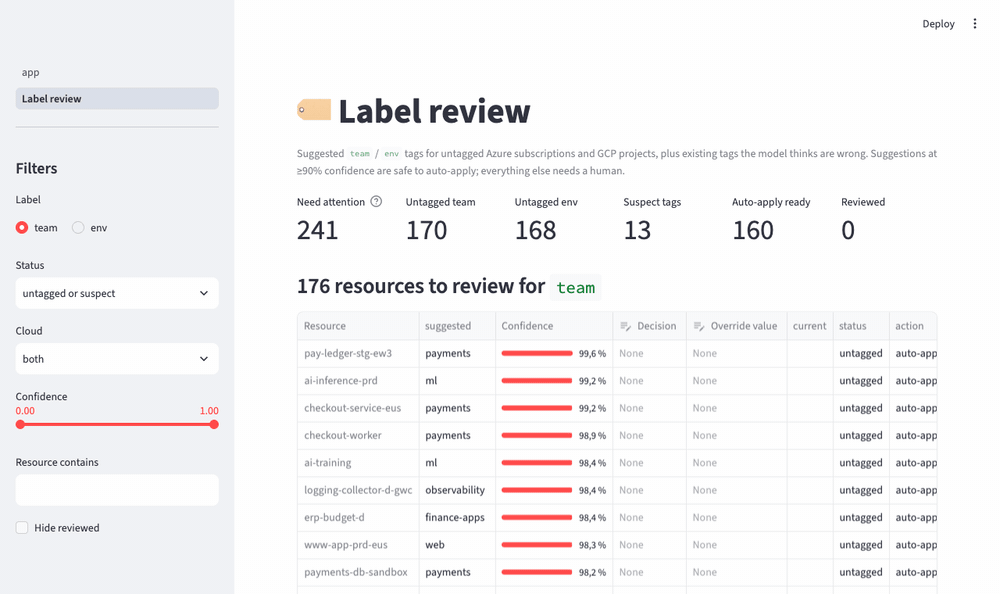
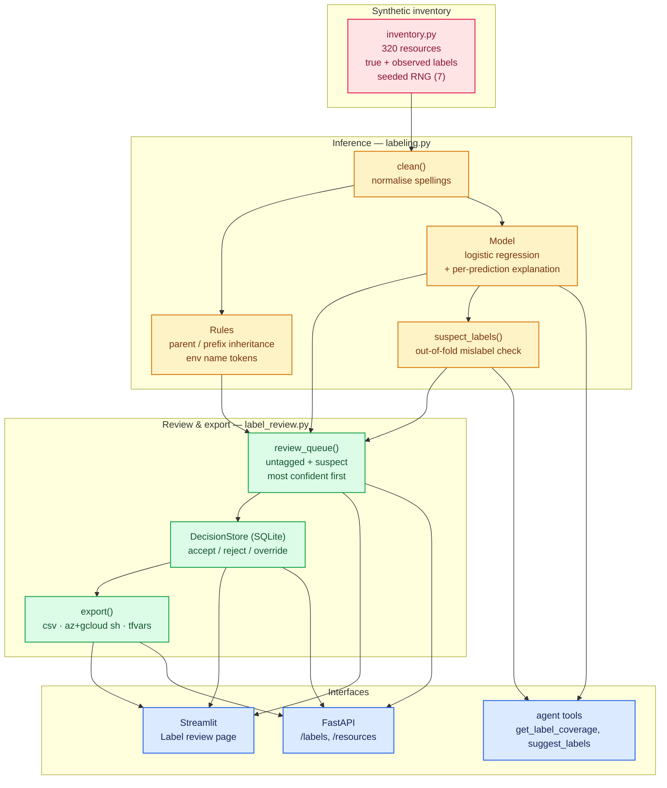

# obs-agent — Tag Inference & Review for Multi-Cloud Cost Estates

[](https://github.com/redbarron23/obs-agent/actions/workflows/ci.yml)
[](LICENSE)

[](https://obs-agent.streamlit.app/Label_review)

**About half of a typical cloud estate has missing or wrong cost tags, so nobody can say which
team owns the spend.** obs-agent infers the missing `team` / `env` / `cost_center` tags across
Azure subscriptions and GCP projects, flags the wrong ones, puts a human in the loop to approve
the changes, and exports them ready to apply as `az` / `gcloud` commands or Terraform.

**[Try the live demo](https://obs-agent.streamlit.app/Label_review)**: no install or API key,
synthetic data, and your review decisions stay private to your browser session. A sleeping app
takes about 30 seconds to wake up.

**Reviews welcome.** I'd value honest feedback: start with the
[four questions in the feedback thread](https://github.com/redbarron23/obs-agent/discussions/26),
or use the [reviewer guide](docs/reviewing.md) to go straight to the claims that matter.



| On a synthetic estate of 320 subscriptions / projects, scored against ground truth | |
|---|---|
| Untagged `team` labels inferred correctly | **98%** (macro-F1 0.98) |
| Precision of the suggestions confident enough to auto-apply (≥90%) | **100%** team · **99%** env |
| Wrong existing tags caught by the mislabel check | 11 of 16, with 11 of 13 flags correct |

These are an upper bound: the synthetic owners map more neatly onto teams than a real estate's
would. A second, deliberately messy estate measures the gap — team accuracy falls 98% → 85% on it,
while auto-apply precision holds at 100% ([details](#how-it-works)).

- **Tag inference** (the core): cleaning, a rules baseline and a scikit-learn model over names,
  folders / management groups, owners, services and spend shape — with a reason and a confidence
  for every suggestion.
- **Human in the loop**: a review queue in the web UI and REST API; accept, reject or override;
  retain each reviewer action with the model's suggestion, confidence and explanation; export as an
  auditable reviewed-only change plan, `az` / `gcloud` script, Terraform tfvars or CSV.
- **Second feature — cost Q&A agent**: *"Which Azure subscription has the highest overage?"*
  answered by tool calls over billing data. See [docs/agent.md](docs/agent.md).
- **Engineering**: ground-truth eval harness, 200+ tests, CI on Python 3.10–3.12,
  FastAPI + Streamlit, Docker Compose, uv.

## The problem

Tag inference is the whole point of this project, so it is worth being precise about the problem
it solves.

Cloud estates are full of subscriptions and projects that were created before a tagging policy
existed. Their `team` / `env` tags are missing, spelled three different ways, or plainly wrong
after a reorg moved a folder. The result is that finance can see a large bill but cannot
attribute it: nobody knows whether `svc-ingest` belongs to Data Platform or Observability, so
nobody can charge it back.

Re-tagging by hand does not scale — a few hundred resources, each needing someone who remembers
its history. So `labeling.py` treats it as a supervised learning problem instead: **train on the
resources that *are* correctly tagged, predict the ones that are not**, and hand the reviewable
suggestions to a human.

### How this differs from tagging tools you may already use

The mature, widely-used tools in this space **enforce** tags; this one **infers** them. That is a
different job, and worth being explicit about:

| | Enforcement tools | obs-agent |
|---|---|---|
| Example | [Cloud Custodian](https://github.com/cloud-custodian/cloud-custodian) (`custodian`), [Yor](https://github.com/bridgecrewio/yor) | this repo |
| Input | Policies you write in YAML / tags declared in IaC | Resources that are already tagged correctly |
| Answers | *"This resource violates the policy"* | *"This untagged resource probably belongs to Data Platform"* |
| Output | A pass/fail decision | A suggestion with a confidence, a reason and alternatives |
| When the tag is unknown | Nothing to enforce — the resource stays untagged | Predicts it, then asks a human to confirm |

Enforcement is the right tool once a tagging policy exists and resources are labelled. It cannot
help with the problem this repo is about, because a resource with no `team` tag *violates no rule
you can write* — there is nothing to compare against. You have to guess the value, which means
being honest about how confident you are.

That is why the output here is a **confidence-thresholded suggestion with a review step**, not a
verdict: auto-apply precision is held at 100% by sending only high-confidence predictions through
unreviewed, and queueing the rest. The two approaches compose rather than compete — infer first to
fill the gaps, then enforce to keep them filled. See
[Where the inferred tags go](#where-the-inferred-tags-go) for hooking the output into the tools
you already run.

## Quick start

```bash
# 1. Clone and set up
git clone https://github.com/redbarron23/obs-agent.git && cd obs-agent
uv sync                                     # install uv: https://docs.astral.sh/uv/

# 2. Score the inference strategies against ground truth
uv run labeling.py

# 3. Review and export the suggestions in the web UI
uv run streamlit run app.py                 # then open the "Label review" page

# 4. (Second feature) ask the cost agent a question — needs Ollama or a provider key
uv run agent.py -q "Which Azure subscription has the highest overage?"
```

Steps 2 and 3 need no API key and no LLM: label inference is plain scikit-learn, and the review
page is a UI over its output. The agent in step 4 is the optional second feature
([docs/agent.md](docs/agent.md)).

## How it works

Typical estates have ~half their Azure subscriptions and GCP projects missing a usable
`team` / `env` tag. `labeling.py` treats this as supervised learning: train on the correctly
tagged resources, predict the rest.

1. **Clean** — normalise spellings (`Prod`, `prd` → `prod`; `o11y` → `observability`). This alone
   recovers ~6% of "unlabelled" resources.
2. **Rules baseline** — inherit team from the parent management group / folder or name prefix
   when ≥80% of labelled siblings agree; env from name tokens (`-prd-`, `-uat-`, `sbx-`).
3. **Model** — logistic regression over name tokens, parent, owners, creator, services and spend
   shape (weekend/weekday ratio, volatility). Every prediction comes with a confidence and the
   features that drove it.
4. **Mislabel check** — out-of-fold predictions flag existing tags the model confidently disagrees
   with.

The synthetic inventory (`inventory.py`, 320 resources) keeps the *true* labels next to the
observed ones, so every strategy is scored against ground truth (`uv run labeling.py`):

| Label | Strategy | Coverage | Accuracy | Macro-F1 | Auto-apply (≥0.9) | Auto-apply precision |
|---|---|---|---|---|---|---|
| team | rules | 41% | 94% | 0.81 | 32% | 94% |
| team | **model** | 100% | 98% | 0.98 | 37% | 100% |
| env | rules | 55% | 100% | 1.00 | 55% | 100% |
| env | **hybrid** | 100% | 81% | 0.79 | 58% | 99% |

Takeaways: rules are precise but cover under half, and parent-folder inheritance is *confidently
wrong* after reorgs, so team uses the model alone. Env is easy when the name says so and hard when
it doesn't (spend alone can't separate dev from staging), so it uses whichever of rule and model is
more confident. The mislabel check caught 6/10 wrong team tags and 5/6 wrong env tags, with 6/6
and 5/7 of its flags correct.

Two agent tools expose this: `get_label_coverage` and `suggest_labels`:

```
Label suggestions for svc-ingest [azure, parent mg-security, owners hana]:
  team untagged (raw value: none)
    → suggest team=data-platform (60% confidence, needs review; via model: strongest signals: creator=hana (+1.27), owner=hana (+0.86), svc=DataFactory (+0.53))
    alternatives: observability 12%, security 8%
    → implies cost_center=CC-2002
```

The numbers above are from the **clean** estate, which is deliberately tidy — the synthetic
owners map more neatly onto teams than a real estate's would. So `inventory.py` also builds a
**harsh** estate (`uv run labeling.py --hardness both`) with the failure modes a real, ungoverned
estate has: shared naming vocabulary, missing owners, reorg-shuffled parents, and fewer resources
whose name carries an `env` token. A separate **reorg** scenario (`uv run labeling.py --hardness reorg`)
isolates stale parent groups while retaining useful names and owners. Scored against the same ground
truth, the drop is what to expect before measuring on your own data:

| team / model | clean | harsh | delta |
|---|---|---|---|
| accuracy | 98% | **85%** | −13% |
| macro-F1 | 0.98 | **0.83** | −0.15 |
| auto-apply coverage (≥0.9) | 37% | **21%** | −16% |
| auto-apply precision | 100% | **100%** | +0% |

Three things worth noting. The **model still beats the rules baseline by a wide margin** — team
rules fall from 94% to 58% accuracy as the hierarchy stops predicting the team, which is the
argument for the model in one table. **Auto-apply precision holds at 100%**: the whole point of the
confidence threshold is that it stays trustworthy on messy data, and it does. But the **mislabel
check degrades badly** — it catches 6/6 genuine wrong team tags on the clean estate and **0** on
the harsh one, because overlapping vocabulary makes the out-of-fold model much less sure. Treat
mislabel flags as a hint to review, not a verdict.

On real data, untagged resources also skew older, so measure on a reviewed sample of them and not
only on held-out tagged ones.

## Review & export

Predictions are only useful once someone applies them. The **Label review** page in the web UI,
and the matching REST endpoints, turn suggestions into tag changes you can apply:

1. **Review queue**: every untagged or suspect label, most confident first, filterable by label,
   status, cloud, confidence and name.
2. **Decide**: per row choose `accept` (apply the suggestion), `reject` (keep today's tag) or
   `override` (pick the right value). "Accept all auto-apply" handles the ≥90% suggestions in one
   click.
3. **Export**: download the resolved changes as CSV, as a shell script of `az tag update` /
   `gcloud projects update --update-labels` commands, or as a Terraform `labels.auto.tfvars.json`
   map. Overrides win over accepts, accepts over auto-apply; rejected suggestions are never
   exported, and `cost_center` follows the team.

### Where the inferred tags go

Deliberately, this repo does **not** ship a policy engine or a reconciler. It answers a question
those tools cannot — *what is this untagged resource?* — and then hands the answer to whatever you
already run, so the tags land in your existing source of truth rather than in a parallel one.

The three export formats map onto the three ways teams apply tags:

| Format | Feeds into | Notes |
|---|---|---|
| `sh` | `az tag update` / `gcloud projects update --update-labels`, or an Ansible/CI step | Merges tags, never removes them (`--operation Merge`), and refuses nothing — read it before running |
| `tfvars` | Terraform | A flat JSON map keyed by subscription/project ID, shaped for `for_each`. GCP values are lowercased automatically, because GCP labels reject uppercase |
| `csv` | A spreadsheet, a ticket, a migration tracker | One row per resource/label pair, with the previous value and how it was decided |

All three carry only the changes a human resolved (or that cleared the 90% auto-apply bar, if you
keep `include_auto=true`), so the diff is the review — you are never applying an unreviewed
inference.

For a safer handoff, download the **Reviewed change plan** first. It is JSON containing only
accepted or overridden changes, the before/after tag diff, and the reviewer/model evidence. Review
and approve that artifact before producing a Terraform or shell export; obs-agent never calls a
cloud API or applies tags itself.

**Composing with enforcement tools.** Once the gaps are filled, tools like
[Cloud Custodian](https://github.com/cloud-custodian/cloud-custodian) and
[Yor](https://github.com/bridgecrewio/yor) are the right ones to keep them filled: Custodian to
detect and remediate drift against your policy, Yor to keep IaC tags traceable to the resources
they create. The natural pipeline is **infer here → review → export → enforce there**, with this
repo responsible only for the step that needs a model.

One gap worth stating plainly: these exports are not a reconciler. Applying the same file twice
issues the same commands twice (harmless — the `az` path merges, and re-setting a value is a
no-op). `drift.detect_drift(previous, current)` compares two inventory snapshots and returns
resources whose hierarchy, owners, services or cost shape changed enough to need review; it does
not collect inventory or mutate cloud tags.

Decisions are stored in a SQLite database (`OBS_AGENT_DECISIONS`, default `label_decisions.db`,
git-ignored). The API and UI share it safely across processes, so a decision made in one shows up
in the other; in Docker Compose both containers mount the `label-state` volume. On first use, a
legacy sibling `label_decisions.json` file is imported automatically.

The same data over HTTP, with no LLM call:

```bash
curl localhost:8000/labels/coverage
curl "localhost:8000/resources?label=team&status=suspect"
curl localhost:8000/resources/svc-ingest/labels
curl -X PUT localhost:8000/resources/svc-ingest/labels/team/decision \
     -H 'content-type: application/json' -d '{"decision": "accept"}'
curl "localhost:8000/labels/export?format=sh&include_auto=false" -o apply-labels.sh
```

## Interfaces

Three ways in — a Streamlit UI, a REST API, and Docker Compose. None of them needs an LLM for
label review; only the optional cost Q&A agent does.

**Web UI** — `uv run streamlit run app.py`. The sidebar has two pages: **Label review** (the review
queue, per-row decisions and the export buttons described above) and **chat** (the cost agent, with
provider/model selection and example prompts).

**REST API** — `uv run uvicorn api:app --reload`, then http://localhost:8000/docs for interactive
specs. Every label action in the UI is also an endpoint, so dashboards and pipelines can call them
directly:

| Endpoint | Purpose |
|---|---|
| `GET /labels/coverage` | Untagged / suspect / auto-apply-ready counts per label |
| `GET /resources` | Review queue, with label / status / confidence / search filters |
| `PUT` / `DELETE /resources/{id}/labels/{label}/decision` | Record or undo a review decision |
| `GET /labels/export?format=csv\|sh\|tfvars` | Resolved changes as a download |

Plus `/ask` and `/ask/stream` (SSE) for the agent, `/health`, and `/providers`.

**Docker** — `docker compose up --build` runs the API on `:8000` and the UI on `:8501`.

Full endpoint tables, error codes, the SSE format and production notes (auth, sticky sessions,
gateway buffering) are in **[docs/api.md](docs/api.md)**.

## Feature 2: the cost Q&A agent

The agent answers cost questions in plain English over the same billing data, using tool calls —
with Ollama (local, free), DeepSeek, Claude or OpenAI:


```
"Which Azure subscription has the highest overage cost?"
"Show me the top 3 most expensive GCP projects"
"Compare costs across Azure and GCP"
```

It is fully documented, including the agent loop, the tool set, the synthetic billing data,
streaming, conversation memory, the CLI, provider support and sample conversations, in
**[docs/agent.md](docs/agent.md)**.

## Evaluation

### Label inference scored against ground truth

`uv run labeling.py` prints the strategy comparison table shown in [How it works](#how-it-works);
add `--hardness both` to score the clean and harsh estates side by side with the degradation table.
The inventory keeps true labels beside observed ones, so every strategy — rules, model, hybrid and
the mislabel check — is scored honestly. Its report also includes expected calibration error (ECE):
the gap between a confidence score and observed accuracy, where lower is better. The synthetic
estate has an explicit calibration budget; a production calibrator should be fitted only from a
reviewed sample of currently unlabelled resources, not from the biased already-tagged subset.
`tests/test_labeling.py` pins accuracy, precision and calibration floors against that ground truth,
so a regression in the model fails CI rather than quietly changing the README's numbers.

### Agent evals

```bash
# Deterministic dry-run — checks tool outputs directly, no API key needed
uv run evals.py --dry-run

# Live evals against the LLM (needs the provider's API key; default: Ollama)
uv run evals.py
uv run evals.py --provider anthropic --model claude-haiku-4-5-20251001

# Verbose output for every case
uv run evals.py --dry-run -v
```

Dry-run mode calls the tools directly and verifies ground-truth identifiers appear in the output —
fully deterministic, suitable for CI. Live mode runs the full agent loop and checks that the LLM's
answer contains the expected facts.

This runs 12 eval cases with known-correct answers. Covers all seven tools:

- Azure top overage, GCP top project, GCP top 3
- Daily trends (Azure and GCP)
- Spike detection (Azure and GCP)
- Multi-cloud summary
- Label coverage, a team suggestion, a suspected-wrong tag
- `label-count-and-team`: count plus team in one question (the issue #5 regression)

#### Latest results

| Mode | Cases | Passed | Needs API key |
|---|---|---|---|
| Deterministic dry-run (`--dry-run`) | 12 | 12 (100%) | No |
| Live, DeepSeek (`--provider deepseek`, `deepseek-chat`) | 12 | 12 (100%) | Yes |
| Live, Ollama (`--provider ollama`, `qwen2.5:7b`) | 12 | 10 (83%): fails `suspect-label`, `label-count-and-team` | No |

The dry-run result is reproducible and runs in CI on every push. Live results for Claude and OpenAI
are not yet published.

Because LLM output is non-deterministic, evals check for **presence of correct facts**
(`must_contain`) rather than exact-string matching — the right testing strategy for AI systems.

### Tracing and eval runs with MLflow (optional)

MLflow is an optional dependency group, so CI, the Docker image and the hosted demo never install
it. Turn it on with an environment variable:

```bash
uv sync --group mlops
OBS_AGENT_MLFLOW=1 uv run agent.py -q "Which team does svc-ingest belong to?"
uv run mlflow ui --backend-store-uri sqlite:///mlflow.db     # http://localhost:5000
```

**Tracing.** Every question becomes one trace: an `agent` span, an `llm: <provider>/<model>` span
per model call (stop reason, tool calls, tokens, served-by model), and a span per tool call with its
inputs and output. MLflow's OpenAI autolog adds SDK-level detail inside the `llm` spans for
DeepSeek, OpenAI and Ollama. The `llm` span is the agent's own, because MLflow's Anthropic autolog
does not patch the beta endpoint or `messages.stream` that Claude Opus 5.5 and streaming use. Set
`MLFLOW_TRACKING_URI` to send traces to a remote server instead of the local `mlflow.db`.

**Eval runs.** `evals_mlflow.py` runs the same 12 cases through `mlflow.genai.evaluate`, one MLflow
run per provider and model, with two scorers:

- `facts_present`: the same fact check as `evals.py`
- `tools_called`: reads the trace and checks the agent called every tool the question needs (the
  tools its dry run uses). A model that guesses can pass the fact check by luck, but not this one.

```bash
uv run evals_mlflow.py --provider deepseek
uv run evals_mlflow.py --provider ollama
```

Recorded runs (2026-10-11):

| Run | `facts_present` | `tools_called` | Failed cases |
|---|---|---|---|
| `deepseek/deepseek-chat` | 100% | 100% | none |
| `ollama/qwen2.5:7b` | 83% | 92% | `gcp-top-3` (skipped the tool), `label-count-and-team` (wrong facts) |

The local model fails different cases from run to run, which is why each run is recorded rather than
reported once. The trace check also caught a flaw in the evals themselves: both models answered
`multi-cloud-summary` with two specific tools instead of `compare_cross_cloud`, which is equally
valid, so cases can now list `accepted_tools`.

## Architecture

The tag inference pipeline is the spine of the project: a synthetic inventory with ground truth,
an inference module that produces scored suggestions, and a review layer that turns the ones a
human accepts into applyable tag changes.



### The inference pipeline

| Module | Role |
|---|---|
| `inventory.py` | Synthetic estate with true *and* observed labels, plus `clean`/`harsh` hardness profiles, so inference can be scored against ground truth and stressed on messy data |
| `labeling.py` | Cleaning, rules baseline, logistic-regression model, out-of-fold mislabel check, evaluation |
| `drift.py` | Snapshot comparison that identifies resources needing a renewed label review |
| `label_review.py` | Review reports, decision store, and CSV / `az`+`gcloud` / tfvars export |

`BEST_STRATEGY` in `labeling.py` picks rules for `env` and the model for `team`, and the reason is
written next to it: parent-folder inheritance is precise but confidently wrong after reorgs, so
`team` is left to the model, while `env` name tokens are near-perfect. That choice is a result, not
a default — the eval table is what justifies it.

The agent side of the repo (`agent.py`, `providers.py`, `tools.py`, `data.py`, `app.py`, `api.py`) is documented in
[docs/agent.md](docs/agent.md), including its architecture diagram.

### File layout

```
obs-agent/
├── labeling.py           # Tag inference: cleaning, rules, model, mislabel check, evaluation
├── drift.py              # Snapshot drift detection for renewed label review
├── inventory.py          # Synthetic inventory (clean + harsh estates) with true vs observed labels
├── label_review.py       # Review reports, decision store, CSV / az+gcloud / tfvars export
├── pages/
│   └── 1_Label_review.py # Streamlit page: review queue, decisions, exports
├── agent.py              # Agent loop + CLI (REPL / --question) + streaming
├── providers.py          # Provider abstraction (Anthropic / OpenAI-compatible) + model config
├── tools.py              # 7 tool functions + LLM tool definitions + dispatch table
├── data.py               # Deterministic synthetic billing data generator (seeded RNG, no CSVs)
├── app.py                # Streamlit web UI (chat page + host for the Label review page)
├── api.py                # FastAPI REST service (/ask, /ask/stream, sessions, label review, API key)
├── evals.py              # 12 eval cases with ground-truth checks against the synthetic data
├── evals_mlflow.py       # Live evals as MLflow runs: fact + trace-based tool scorers
├── observability.py      # Optional MLflow tracing (agent / llm / tool spans); no-op when off
├── tests/
│   ├── conftest.py       # Shared fixtures
│   ├── test_agent.py
│   ├── test_api.py
│   ├── test_evals.py
│   ├── test_labeling.py
│   ├── test_label_review.py
│   ├── test_model_config.py
│   ├── test_observability.py
│   └── test_tools.py
├── docs/
│   ├── agent.md          # The cost Q&A agent, in full
│   ├── api.md            # REST API reference, errors, production notes, Docker, hosted demo
│   ├── testing.md        # Test strategy, what mocks cannot catch, test groups
│   ├── reviewing.md      # For peer reviewers: load-bearing claims, where to look, what to skip
│   └── references.md     # Sources for the inference, tagging, tool-use and eval design
├── .github/workflows/
│   └── ci.yml            # Unit tests + eval dry-run + Docker build/smoke test
├── Dockerfile
├── docker-compose.yml    # API on :8000 + Streamlit UI on :8501
├── .env.example
├── pyproject.toml        # Dependencies (single source of truth)
├── uv.lock               # Exact locked versions (commit with pyproject.toml)
├── .python-version       # Local Python version for uv
├── LICENSE
└── README.md
```

## Design decisions

### Why a synthetic inventory with true labels?

Real billing exports contain sensitive subscription IDs and project names, and — more importantly
for this project — they do **not** contain ground truth. You cannot score an inference method
against a label you do not have. Keeping a *true* label beside every *observed* one means the
rules, the model and the mislabel check can all be measured honestly, and the eval is fully
reproducible. The same reasoning applies to the agent's billing data ([docs/agent.md](docs/agent.md)).

### Why fact-presence checks instead of exact matching?

Most software lets you write deterministic tests. Agent behaviour is non-deterministic — the same
question can get different phrasings. The eval harness in this project shows the right testing
strategy for this world: check that *correct facts* appear in the output, not that the exact
wording matches.

### Why a provider abstraction?

Building API-agnostic agents is a practical skill for production systems where provider lock-in is
a concern. The `Provider` class in `providers.py` shows how to switch between Anthropic and
OpenAI-compatible backends without changing the tool logic or agent loop.

## What this project demonstrates

| Concept | Implementation |
|---|---|
| **Supervised inference** | Train on correctly tagged resources, predict the untagged ones |
| **Leakage-free evaluation** | Out-of-fold predictions so a resource never votes on itself |
| **Honest metrics** | Ground-truth inventory, pinned accuracy/precision floors in CI |
| **Explainable predictions** | Per-suggestion confidence, driving features and alternatives |
| **Human in the loop** | Review queue, accept/reject/override, resolution order in one place |
| **Applyable output** | `az` / `gcloud` script and Terraform tfvars, not just a CSV |
| **Agent loop** | Provider-agnostic request → dispatch → feed-back cycle until `end_turn` |
| **Streaming** | Token-by-token output through the full tool-use loop (Anthropic + OpenAI SSE) |
| **Conversation memory** | Multi-turn REPL with history pruning at 20 messages |
| **Provider abstraction** | `Provider` class wrapping Anthropic and OpenAI-compatible APIs |
| **Tool definitions** | JSON Schema input specs that the model calls dynamically |
| **Evals** | Fact-presence checks (`must_contain`) instead of brittle exact-string matching |
| **Deterministic test data** | Seeded RNG for reproducible dev, test, and CI |

## Requirements

- Python 3.10+
- [uv](https://docs.astral.sh/uv/) for Python, environments and dependencies (used locally, in CI
  and in the Dockerfile)
- **Label inference and review**: no LLM, no API key, no extra services
- The cost agent (optional) additionally needs **Ollama** (default, no key) or a
  **DeepSeek / OpenAI / Anthropic** key: `DEEPSEEK_API_KEY` / `OPENAI_API_KEY` / `ANTHROPIC_API_KEY`

### Dependencies

`pyproject.toml` is the single source of truth and `uv.lock` pins exact versions; both are
committed. Runtime deps are under `[project] dependencies`, test tools under the `dev` dependency
group (installed by `uv sync`, left out of the Docker image).

```bash
uv sync                      # create/update .venv from uv.lock (Python version from .python-version)
uv run <command>             # run anything inside that env, no activation needed
uv add <package>             # add a runtime dependency (updates pyproject.toml + uv.lock)
uv add --dev <package>       # add a test/dev dependency
uv lock --upgrade            # bump locked versions within the declared ranges
```

CI runs `uv sync --locked`, which fails if `uv.lock` is out of date with `pyproject.toml`. Commit
both files together.

## Testing

The suite is fast, offline and deterministic — which is also its main limitation. A green run means
**the code behaves as written**, not that **the model answers well**. Three layers answer three
different questions:

| Layer | Count | Question it answers | Runs in CI? | API key? |
|---|---|---|---|---|
| Unit tests | 232 | Does the code do what it says? | Yes | No |
| Eval dry-run | 12 | Do the tools still return the facts answers depend on? | Yes | No |
| Live evals | 12 | Does the model actually use them correctly? | No | Yes |

```bash
uv run pytest tests/ -q                        # unit tests (no provider needed)
uv run evals.py --dry-run                      # deterministic eval check
OBS_AGENT_RUN_LIVE_EVALS=1 uv run pytest tests/ -m integration   # live evals (costs money)
```

Everything under `tests/` runs without a provider: `test_tools.py` patches the module-level
DataFrames with small hand-built fixtures, and `test_agent.py` mocks `Provider.create` so the loop
is driven by a scripted response. The 12 live evals are skipped unless the flag *and* the provider's
key are set, so they can never fire by accident or run up a bill in CI.

CI runs the first two on every push/PR across Python 3.10–3.12, plus a Docker job that builds the
image and smoke-tests `/health`.

**[What the mocks cannot catch, the full test-group table and the regression floors → docs/testing.md](docs/testing.md)**

Reviewing the project, or judging whether the numbers hold up? **[docs/reviewing.md](docs/reviewing.md)**
points at the load-bearing claims and where a second pair of eyes is worth most.

## References

Sources for the inference approach, cloud tagging semantics, LLM tool use and LLM evaluation
patterns are listed in **[docs/references.md](docs/references.md)**.

## License

MIT — see [LICENSE](./LICENSE).

## Related projects

### [rag-observability](https://github.com/redbarron23/rag-observability) — RAG over Observability Docs

A standalone Retrieval-Augmented Generation system that answers natural-language questions about
multi-cloud observability architecture, coverage targets, and monitoring standards. Built on real
domain documentation.

```
Q: What is the coverage target for Tier 1 production resources?
A: The production Tier 1 coverage target is 85% within 4 months and 100%
   within 9 months (source: coverage-targets.md, section 'Tier 1').
```

**Pipeline:** `.md` documents → heading-aware chunking → `all-MiniLM-L6-v2` embeddings → ChromaDB
vector store → cosine similarity retrieval → Claude with cited generation.

**Key differences from obs-agent:**

| Concern | obs-agent | rag-observability |
|---|---|---|
| **Pattern** | Supervised inference + tool-use agent | RAG (retrieval + generation) |
| **Data** | Synthetic inventory + billing DataFrames | Real documentation (.md files) |
| **LLM role** | Optional: answers cost questions via tools | Answers from retrieved context |
| **Memory** | Multi-turn conversation (20 msg history) | Stateless per query |
| **Eval focus** | Ground-truth accuracy + fact presence | Source attribution + fact presence |
| **Providers** | Ollama, DeepSeek, OpenAI, Anthropic | Anthropic, DeepSeek |

**References:**
- [ChromaDB](https://www.trychroma.com/products/chromadb) — vector database
- [RAG 101: Demystifying RAG Pipelines](https://developer.nvidia.com/blog/rag-101-demystifying-retrieval-augmented-generation-pipelines/) — NVIDIA
- [Sentence Transformers](https://www.sbert.net/) — embedding models (`all-MiniLM-L6-v2`)
- [Evaluating RAG: Metrics and Methods](https://www.rungalileo.io/blog/evaluating-rag-a-comprehensive-guide-to-metrics-and-methods) — Galileo
- [LangSmith RAG Evaluation](https://docs.smith.langchain.com/faq/evaluation/eval_rag) — production eval patterns
