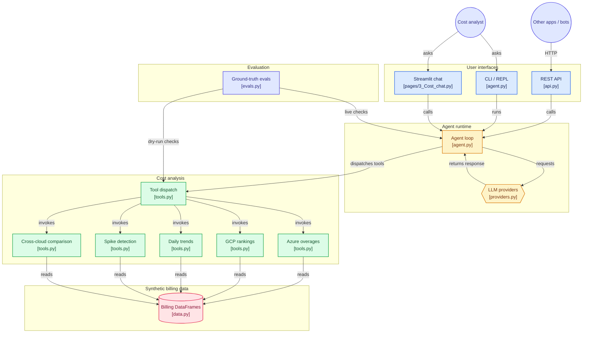

# The cost Q&A agent

The second feature of obs-agent: a tool-calling LLM agent that answers cost
questions in plain English over multi-cloud billing data. The **tag inference
and review** system is the project's core — see the [main README](../README.md).
This document covers the agent in full.


Ask questions and get answers grounded in actual numbers:

```
"Which Azure subscription has the highest overage cost?"
"Show me the top 3 most expensive GCP projects"
"Compare costs across Azure and GCP"
"Has subscription sub-a1b2c3d4 had any cost spikes recently?"
"What's the daily trend for project-bravo?"
```

The agent decides which tools to call, executes them against the billing data,
and summarises the findings — concisely, with actual dollar figures.

## The agent loop (`agent.py`)

The standard tool-use pattern:

1. Send the user's question + tool definitions to the model
2. If the model requests a tool, execute it via `TOOL_DISPATCH` and feed the result back
3. Repeat until the model produces a final answer

Supports both **batch** (full response at once) and **streaming** (token-by-token) modes. The `Provider` class abstracts over Anthropic and OpenAI-compatible (DeepSeek) APIs, handling differences in request format, response shape, and stop-reason naming.

## Module layout

| Module | Contents |
|---|---|
| `agent.py` | The agent loop (`run`, `stream_run`), history pruning, turn bookkeeping, CLI entrypoint. Re-exports the names below, so `from agent import ...` keeps working. |
| `providers.py` | `Provider` (the Anthropic / OpenAI-compatible abstraction), message formatting, the system prompt, provider and model config (`check_config`, `default_model`, `model_warning`, `max_tokens_setting`). |
| `tools.py` | The seven tool functions, their LLM-facing definitions, and the dispatch table. |

## The tools (`tools.py`)

| Tool | Purpose |
|---|---|
| `get_azure_top_overages` | Top N Azure subscriptions by estimated 30-day overage cost |
| `get_gcp_top_projects` | Top N GCP projects by total logging cost |
| `get_daily_trend` | Day-by-day cost/ingestion trend for a given subscription or project |
| `find_spikes` | Detects days where cost jumped >X% vs the previous day. Optional `platform` (`azure`/`gcp`/`all`) and `limit` (default 10); results are ranked by dollar cost and the total count is reported when truncated |
| `compare_cross_cloud` | Total cost comparison across Azure and GCP with per-sub/project breakdown |

Each tool returns a clean formatted string so the model gets compact, readable results. Tools are pure functions operating on in-memory DataFrames — no network calls, no side effects.

Two further tools bridge to the tag inference system: `get_label_coverage` and
`suggest_labels` (see [How it works](../README.md#how-it-works)).

### Cross-cloud cost comparison

A single tool that sums costs across both clouds and provides per-subscription and per-project breakdowns:

```
Cross-Cloud Cost Summary (30 days)
========================================
Azure total overage cost:  $23,059.00
GCP total logging cost:    $21,705.00
────────────────────────────────────────
Grand total:               $44,764.00
```

## The data (`data.py`)

Generates 60 days of realistic multi-cloud billing data with a fixed random seed (42):

- **5 Azure subscriptions** with varying ingestion/overage levels — one dominant, one near-zero
- **5 GCP projects** with different cost profiles
- **Built-in cost spikes**: `sub-a1b2c3d4` spikes to $45 on day 30, `project-bravo` spikes to $28 on day 20
- **Deterministic**: every run produces the same IDs, costs, and patterns, so evals always pass

Label inference uses a separate inventory (`inventory.py`, own seed) so it never changes these numbers.

No external CSVs required. The project runs entirely from synthetic in-memory data. To use real billing data, swap the DataFrames in `data.py` — the rest of the code doesn't care where the data comes from.

Key identifiers in the synthetic data:

| Cloud | Subscriptions / Projects | Known spike |
|---|---|---|
| Azure | `sub-a1b2c3d4` (dominant, $18,411 overage), `sub-e5f6g7h8`, `sub-i9j0k1l2`, `sub-m3n4o5p6`, `sub-q7r8s9t0` (near-zero) | Day 30: $45 → triggered by `--threshold 50` |
| GCP | `project-alpha` (highest, $12,672), `project-bravo`, `project-charlie`, `project-delta`, `project-echo` (lowest) | Day 20: $28 |

## Architecture diagram

```
You ──question──▶  agent.py  ──tools──▶  tools.py  ──data──▶  data.py
                    │      └──▶  providers.py  ──▶  LLM API
                    │                                              │
                    │  (LLM API loop)                             (in-memory
                    │   tool_use ↔ end_turn                       DataFrames)
                    │   streaming supported
                    │   conversation memory persists
                    │
                    ▼
               answer (printed / streamed / rendered in web UI)
```



## Streaming output

Watch tokens arrive in real-time instead of waiting for the full response:

```bash
uv run agent.py -q "Compare costs across Azure and GCP" --stream
```

Streaming works through the full tool-use loop — if the model calls a tool mid-stream, it prints text up to that point, executes the tool, and continues streaming.

## Multi-turn conversation memory

The REPL and web UI remember previous turns. Ask follow-up questions naturally:

```
You: Which Azure subscription has the highest overage?
Agent: sub-a1b2c3d4 at $18,411...

You: Show me its daily trend
Agent: (remembers which subscription you meant and fetches the trend)
```

Message history prunes to the most recent complete conversation turns, so tool calls and results remain valid for the provider API.

## CLI with scripting

```bash
# Single answer (for scripts, CI, or demos)
uv run agent.py -q "Show me the top 3 GCP projects"

# Stream mode
uv run agent.py -q "Any cost spikes?" --stream

# Verbose mode (see tool calls)
uv run agent.py -q "Compare costs" --verbose

# Specific model
uv run agent.py -q "Show me spikes" --model claude-opus-5-5
```

## Provider support

| Provider | Default model | Env variable |
|---|---|---|
| **Ollama** (local, default) | `qwen2.5:7b` | none — runs locally |
| **DeepSeek** | `deepseek-chat` | `DEEPSEEK_API_KEY` |
| **Anthropic** | `claude-opus-5-5` | `ANTHROPIC_API_KEY` |
| **OpenAI** | `gpt-5.4-mini` | `OPENAI_API_KEY` |

Switch providers:
```bash
# Use Anthropic instead of Ollama
uv run agent.py --provider anthropic -q "Which Azure subscription has the highest overage?"

# Pick a specific Ollama model (no API key needed)
uv run agent.py --model qwen2.5:7b -q "Compare Azure and GCP"
```

### Choosing the default provider and model

Set `OBS_AGENT_PROVIDER` (and optionally `OBS_AGENT_MODEL`) once, for example in `.env`, and the CLI, the REST API, the web UI and Docker Compose all use it. `--provider` / `--model` flags, the API's `provider` / `model` fields and the UI dropdown still override it per call. An unsupported value stops the CLI and API at startup with a clear message.

```bash
export OBS_AGENT_PROVIDER=deepseek     # or anthropic / openai; unset = ollama
uv run agent.py -q "How many projects are missing a team tag?"
```

Small local models answer fast and free but can misread tool output or guess. On the regression question *"How many projects are missing a team tag, and which team does svc-ingest probably belong to?"* (eval `label-count-and-team`), `qwen2.5:7b` gave the right count but invented a team, while `deepseek-chat` called both tools and answered correctly. So every interface flags it: the UI sidebar shows a warning, `/ask` returns a `warning` field, and the CLI prints a note. `/ask` and the UI also report which model actually answered (`served_by`), which can differ from the requested one when Claude's refusal fallback kicks in.

With Claude Opus 5.5, Sonnet 5.5 or Fable 5.1, requests use adaptive thinking at `medium` effort, pass thinking blocks back unchanged between tool calls, drop stale ones after history pruning instead of failing, and opt into server-side refusal fallbacks. Those models get a 16k-token budget, since thinking counts against it.

Models without adaptive thinking get `OBS_AGENT_MAX_TOKENS` (default **4096**) for the answer, which also covers tool-call payloads. Older builds capped this at 1024, which silently truncated long answers; now, when a response does hit the cap, the agent appends a note saying so and naming the setting to raise, instead of returning a partial answer that looks complete.

```bash
export OBS_AGENT_MAX_TOKENS=8192   # long answers or large tool payloads
```

The provider abstraction (`Provider` class in `providers.py`) wraps both APIs behind a common interface, so tool logic and the agent loop work identically regardless of backend.

## Sample conversations

All examples use the synthetic data (seed 42) so you get identical output. Run them yourself:

### Single question with streaming

```bash
uv run agent.py -q "Which Azure subscription has the highest overage cost?" --stream
```

Live output (streaming, token by token):

```
The Azure subscription with the highest overage cost is **sub-a1b2c3d4**, with an estimated
overage cost of **$18,411.00** over the last 30 days. It ingested 42.8 GB of log data,
with 3.7 GB exceeding its allocation.
```

### Verbose mode (see tool calls)

```bash
uv run agent.py -q "Find cost spikes in the last 60 days" --verbose
```

```
  [stop_reason: tool_use]
  [tool: find_spikes({'threshold_pct': 200})]
  [tool result: find_spikes({'threshold_pct': 200})]
  [stop_reason: end_turn]

Spikes detected (both clouds):

[Azure]
  • sub-a1b2c3d4 — day 30: $45.00 (+350% vs $10.00 previous day)

[GCP]
  • project-bravo — day 20: $28.00 (+180% vs $10.00 previous day)
```

### Multi-turn conversation (REPL)

```
$ uv run agent.py
obs-agent — Multi-Cloud Cost Triage Agent
Provider: anthropic  |  Model: claude-opus-5-5  |  Mode: batch  |  Type 'quit' to exit.

You: Which GCP project costs the most?
Agent: **project-alpha** is the most expensive at **$12,672.00** over the past 30 days.

You: Show me its daily trend
Agent: (remembers you mean project-alpha, fetches the trend)

Daily cost trend for project-alpha:
  Day        Cost
  ─────────────────
  2026-05-01   $42.00
  2026-05-02   $38.00
  ...
  2026-06-29   $45.00

You: How does that compare to Azure's total?
Agent: Let me look at both clouds together...

Cross-Cloud Cost Summary (30 days)
========================================
Azure total overage cost:  $23,059.00
GCP total logging cost:    $21,705.00
────────────────────────────────────────
Grand total:               $44,764.00
```

### DeepSeek as provider

```bash
export DEEPSEEK_API_KEY=sk-...
uv run agent.py --provider deepseek --model deepseek-chat -q "Top 3 GCP projects" --verbose
```

### Ollama (local)

```bash
# Make sure Ollama is running with a model that supports tools
# (qwen2.5, llama3.1, etc.)
ollama pull qwen2.5:7b

# Run the agent — no API key needed
uv run agent.py --provider ollama --model qwen2.5:7b -q "Compare costs across Azure and GCP"

# Stream mode works too
uv run agent.py --provider ollama --model qwen2.5:7b -q "Any cost spikes?" --stream --verbose

# Custom host (if Ollama isn't on localhost)
export OLLAMA_HOST=http://my-server:11434
uv run agent.py --provider ollama --model qwen2.5:7b -q "Which Azure sub has the highest overage?"
```

## Web UI example prompts

Launch `uv run streamlit run app.py`, open **Optional cost chat**, select your provider, and try:

- *"Which Azure sub costs the most?"*
- *"Show me top 3 GCP projects"*
- *"Any recent cost spikes?"*
- *"What's the daily trend for sub-a1b2c3d4?"*
- *"Compare costs across both clouds"*

The web UI maintains conversation history between turns, so follow-ups like *"show me its daily trend"* work naturally. Enable **Stream responses** in the sidebar to watch tokens arrive in real time.
