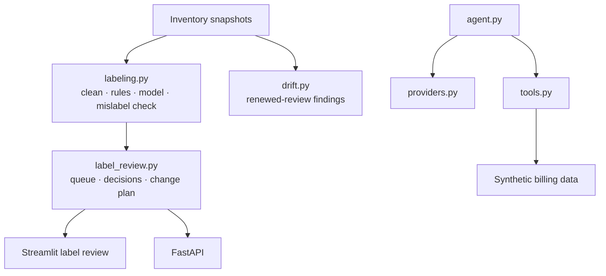

# Architecture and design decisions

## System map

The label-inference flow and cost-agent flow share a user interface but are independent: tag review
needs no LLM, while cost Q&A uses an LLM only to choose and summarise deterministic tools.

## Key modules

| Module | Responsibility |
|---|---|
| `inventory.py` | Seeded synthetic inventory with true and observed labels |
| `labeling.py` | Cleaning, rules, logistic regression, explanations, and scoring |
| `label_review.py` | Review decisions, append-only feedback, change plans, and exports |
| `drift.py` | Snapshot comparison for renewed review |
| `agent.py` / `providers.py` | Bounded tool-use loop and provider abstraction |
| `tools.py` / `data.py` | Deterministic cost-analysis functions and billing data |
| `api.py` / `pages/` | REST and Streamlit surfaces |

## Design decisions

### Synthetic data with ground truth

Real billing exports are sensitive and lack authoritative labels for every resource. Synthetic true
labels make inference, thresholds, and degradation scenarios measurable and reproducible without
claiming that the result transfers automatically to a real estate.

### Human approval before application

Inference is a recommendation, not a mutation. The reviewed change plan creates a clear trust
boundary between model output and a team's Terraform, CI, or shell-based delivery process.

### Provider abstraction for the agent

The cost agent keeps message formats and tool-loop logic separate from provider SDK details. It can
switch between Anthropic and OpenAI-compatible providers without changing tool implementations.

### Tests check facts, not phrasing

Agent answers vary in wording. Evaluations therefore test for the facts a correct answer must
contain and, where useful, whether the expected tool path was used.
