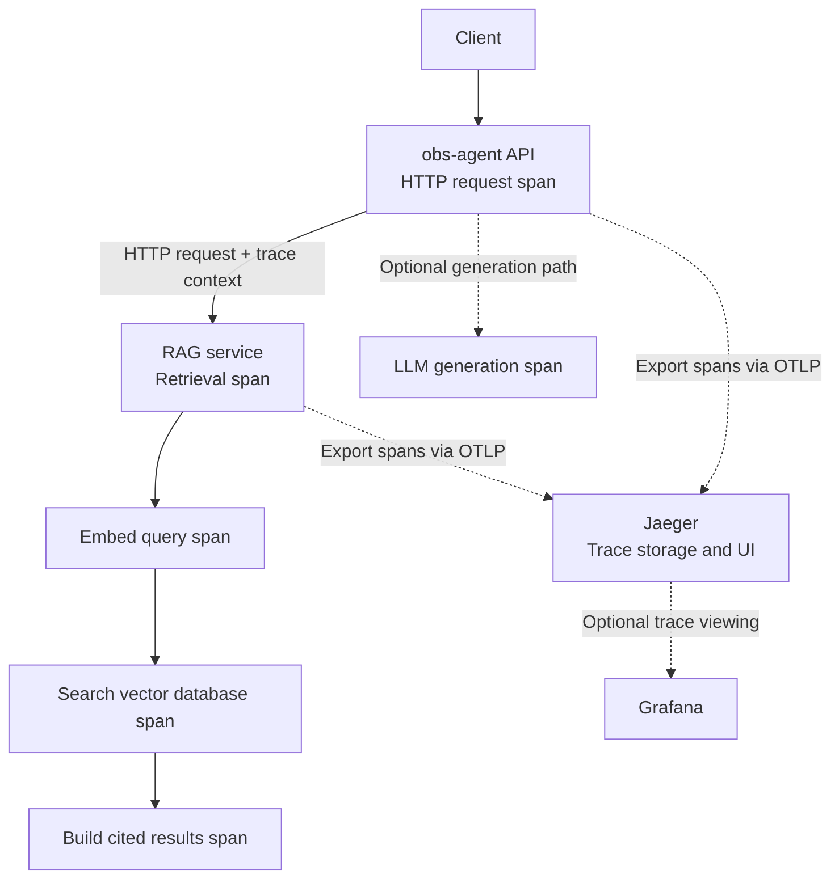

# Evaluation and observability

## Label-inference quality

`inventory.py` keeps ground truth beside deliberately incomplete and messy observed tags. The label
tests pin quality floors against that ground truth, including auto-apply precision on the adversarial
estate. The report also includes expected calibration error (ECE), the gap between the model score
(reported as confidence) and observed accuracy; lower is better. Team ECE is 17–18%, so the score
is a ranking signal, not a calibrated probability.

For `team`, the report adds an `abstain` row: the team model with
[insufficient-evidence](label-inference.md#insufficient-evidence) cases withheld, as reviewers see
it. Its accuracy is over the suggestions made, so always read it with its coverage, the number
withheld per evidence status, and how often the withheld value would have been right. On the harsh
estate it suggests a team for 77% of untagged resources at 94% accuracy, against 100% at 85% without
abstention; the withheld 23% would have been right 53% of the time.

```bash
uv run labeling.py --hardness both
uv run pytest tests/test_labeling.py -q
```

Synthetic evaluation is necessary but insufficient. In production, validate the model with a
reviewed sample of unlabelled resources, then use reviewer feedback to monitor calibration and
retrain only when enough representative data exists.

For a repeatable 50–100-resource production-validation process, including anonymisation and a
threshold recommendation that defers when evidence is insufficient, use the
[real-world evaluation pack](real-evaluation.md).
Changing the expedited-review threshold also requires the documented
[approval process](deployment.md#confidence-threshold-changes).

## Anonymized review fixture and post-review metrics

[`fixtures/anonymized_review_feedback.json`](../fixtures/anonymized_review_feedback.json) is a
small, hand-curated production-style sample with opaque resource IDs and no people, account IDs,
or billing data. It exercises the feedback-reporting contract without claiming to be a production
benchmark. Replace it with an approved, anonymized export before drawing conclusions about a real
estate.

Every review action retains the original suggestion and the reviewer outcome. `GET
/labels/feedback/metrics` reports macro precision, recall, and F1 against the reviewer-resolved
value, grouped by label and month. An accept or override supplies that value; a rejection of an
already-tagged resource uses its prior label. Rejecting an untagged suggestion is **unresolved**,
not a false label, because no replacement truth was supplied.

The Label review page shows the same report in its **Review quality** panel, including monthly
trends and a below/at-or-above-90% confidence split. Watch whether high-confidence agreement
falls relative to lower-confidence review: that is a practical signal to revisit the threshold.

These are reviewer-agreement metrics, not an unbiased production benchmark: reviewers choose what
to inspect, and repeated decisions are retained as historical events. Track the `reviewed`,
`scored`, and `unresolved` counts with the scores; do not compare periods with too little reviewed
data. Overrides of a withheld (abstained) suggestion resolve the label but have no suggestion to
score; they are counted as `abstained`, not `unresolved`.

## Cost-agent evaluations

The agent has three complementary layers:

| Layer | Question | CI | Provider key |
|---|---|---:|---:|
| Unit and integration tests | Does code behave as written? | Yes | No |
| Eval dry-run | Do tools still expose the needed facts? | Yes | No |
| Live evaluation | Does a real model choose and use tools correctly? | No | Yes |

```bash
# Deterministic, offline evaluation.
uv run evals.py --dry-run

# End-to-end evaluation against a configured provider.
uv run evals.py
uv run evals.py --provider anthropic --model claude-haiku-4-5-20251001
```

The 12 cases cover rankings, trends, spikes, cross-cloud summaries, label coverage, suggestions,
and suspected wrong labels. They use fact-presence checks rather than exact text because correct
agent answers can be phrased differently.

## Jaeger and distributed tracing

Jaeger is a tool for distributed tracing: it helps follow a request across services and inspect
where time is spent or errors occur. For example, a RAG request might travel through
`API → RAG service → vector database → LLM`.

Each timed operation is a **span**; related spans for one request form a **trace**. Jaeger displays
them as a timeline, making slow operations and failed calls easier to locate.

The three common observability signals answer different questions:

| Signal | Example |
| --- | --- |
| Metrics | Requests are getting slower. |
| Logs | A database query timed out. |
| Traces | The database call consumed most of this request's time. |

Applications commonly use OpenTelemetry to instrument operations and send traces to Jaeger for
storage and viewing. Jaeger needs trace instrumentation and export configured in the application.

This project currently documents optional MLflow tracing below; these Jaeger notes explain the
concept and do not add a Jaeger integration.

### Defining spans for a local experiment

Define spans around operations worth measuring. Each span records a name, start/end time,
status, and useful attributes. A proposed RAG trace could look like this:

```text
HTTP request                     ← root span
└── Retrieve policy context
    ├── Embed query
    ├── Search vector database
    └── Build cited results
```

For a request that also generates an answer, add an LLM generation span. Useful attributes include
service name, model, result count, and response status. Do not record API keys, private documents,
or raw user questions by default.

OpenTelemetry creates and exports spans; Jaeger stores and displays them. Propagate trace context
through HTTP headers to connect spans across the API and RAG service. The existing MLflow agent,
model, and tool spans provide operation boundaries to consider when planning this instrumentation.
These are proposed boundaries; the exact instrumentation points still need to be checked.

### Proposed request and trace flow

Solid arrows show the request path. Dotted arrows show telemetry export and viewing; each service
creates spans using OpenTelemetry, while HTTP trace context connects them into one trace.



Embedding, search, and result-building spans are children of the retrieval span, as shown in the
span tree above; their arrows here show operation order. The optional LLM span belongs to the
request's generation path, and its export follows the instrumentation of its owning service.
Grafana is optional because Jaeger has its own UI. This is a proposed experiment, not a diagram
of instrumentation already running in this project.

### Experiment considerations

| Consideration | Initial approach |
| --- | --- |
| Learning goal | Ask where retrieval spends time; instrument operations that answer that question. |
| Cross-service context | Propagate HTTP trace context and confirm API and RAG spans share a trace ID with the correct parents. |
| Privacy | Start with timings, counts, and status; exclude API keys, questions, document excerpts, and model responses by default. |
| Sampling and retention | Capture every request in the small local demo; set a short retention period and limit sampling/storage before increasing traffic. |
| Failures and overhead | Exercise slow retrieval, a RAG outage, and an unavailable tracing backend; exporting traces must not break application requests or cause unbounded buffering. |
| MLflow overlap | Use Jaeger to investigate service latency and request flow; retain MLflow for existing agent traces and evaluations, and check for duplicate instrumentation. |
| Local exposure | Bind experimental tracing interfaces to loopback and use fictional or sanitized data. |

Start with one successful retrieval and one failed retrieval. Verify the span hierarchy, timings,
error status, and cross-service trace continuity in Jaeger. Then check a deliberately slow request
and tracing-backend downtime. Exporter configuration and MLflow interoperability still need to be
checked before implementation; the first experiment needs no Grafana deployment.

## MLflow

MLflow is an optional dependency group for traces and comparable live-evaluation runs. The
dedicated `mlops` CI job installs it; ordinary test jobs, the default Docker image, and the hosted
demo do not. Start with the [MLflow walkthrough](mlflow.md) for the vocabulary, an offline trace
exercise, UI inspection, evaluation limits, and troubleshooting.

```bash
uv sync --locked --group mlops
OBS_AGENT_MLFLOW=1 uv run --group mlops agent.py -q "Which team does svc-ingest belong to?"
uv run --group mlops evals_mlflow.py --provider deepseek
uv run --group mlops mlflow ui --backend-store-uri sqlite:///mlflow.db --host 127.0.0.1
```

Traces record agent, model, and tool spans. `evals_mlflow.py` scores both facts-present and
tools-called, so the fact-presence check alone cannot hide a skipped required tool. These checks
do not establish complete semantic correctness. Agent and evaluation commands above call a real
provider; hosted providers can incur charges.

For test commands, limitations, and the CI matrix, see [Testing](testing.md).
